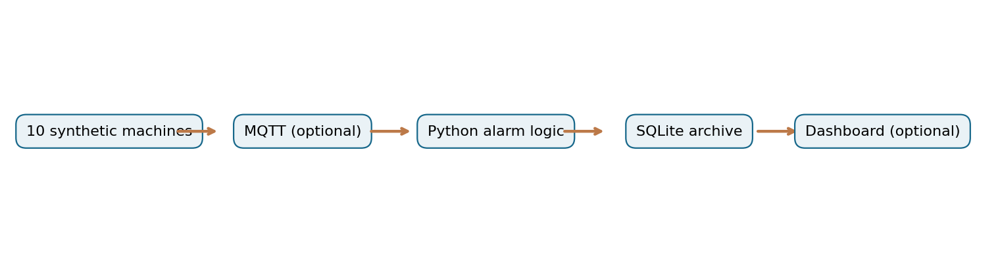

# Smart Factory Monitoring

**Industrial IoT monitoring prototype and project-management case study**  
Wassim Hamdi · 2026

An independent, fictional case study inspired by industrial condition monitoring. **Not a Robert Bosch GmbH project or collaboration.** All factory equipment, staffing, budgets, approvals, and management test runs are simulated.

The project combines a working offline Python prototype for ten synthetic machines with a structured project plan, requirements baselines, a change request, risk analysis and test traceability.

## Project deliverables

- [Technical and project-management report (PDF, German)](docs/Bosch_Smart_Factory_Project_Report.pdf)
- [Project presentation (PDF, 10 slides)](presentation/Smart_Factory_Monitoring_Presentation.pdf)
- [Planning workbook (Excel)](project_management/Hamdi_Wassim_PM_Arbeitsmodell.xlsx)
- [Requirements and test traceability](project_management/traceability_matrix.csv)
- [Change request CR-001](project_management/CR-001.md)
- [Risk register](project_management/risk_register.csv)

## Monitoring prototype

The Python prototype in [`src/`](src/) generates deterministic temperature and vibration readings, validates UTC timestamps and machine IDs, evaluates alarm thresholds, stores readings in SQLite and exports alarm events to CSV. The MQTT adapter and Streamlit dashboard are optional examples; neither represents an industrial deployment.

| Item | Configuration |
| --- | --- |
| Machine IDs | M-01 through M-10 |
| Temperature threshold | Alarm above 80.0 °C |
| Vibration threshold | Alarm above 7.0 mm/s |
| Data | Synthetic readings; one-second timestamp increments |
| System boundary | Alerts and visualization only; **no machine control** |

## Engineering and planning scope

Fifteen requirements, thirteen planned test cases and ten work packages form the traceable planning baseline. The original baseline **B1** is kept alongside the revised **B2**, which incorporates the modeled change request CR-001.

| Planning baseline | Duration | Planned effort | Modeled budget including reserve |
| --- | ---: | ---: | ---: |
| B1 | 12 weeks | 496 h | €42,856 |
| B2 | 13 weeks | 516 h | €44,528 |

CR-001 tightens the planned alarm-display latency target from 2.0 s to 1.0 s, adding 20 planned hours and €1,672 including reserve. This target has **not** been verified by an end-to-end industrial test.

The [Polarion concept](project_management/polarion_concept/) illustrates requirement links, coverage and change impact. The [Jira concept](project_management/jira_concept/) maps planned work packages to issues. These are independent diagrams and data mappings, **not exports or screenshots from live Jira or Polarion**.

## Verification status

The Python unit tests are executed locally against the offline prototype. Their [test log](project_management/evidence/local_python_unittests.txt) is distinct from the five **simulated** management test runs recorded in [`simulated_runs.csv`](project_management/evidence/simulated_runs.csv): four hypothetical passes and one hypothetical failure linked to [DEF-001](project_management/evidence/DEF-001.md). The 60-minute persistence target, live MQTT ingestion and end-to-end latency remain unverified.

## Repository structure

| Directory | Content |
| --- | --- |
| [`src/`](src/) | Offline monitoring prototype, optional MQTT adapter and dashboard |
| [`tests/`](tests/) | Python unit tests |
| [`project_management/`](project_management/) | Baselines, test cases, traceability, planning, risks and tool concepts |
| [`docs/`](docs/) | Report and architecture diagram |
| [`presentation/`](presentation/) | Project slides |

The repository includes MIT-licensed software. Third-party trademarks and referenced material remain the property of their respective owners.
